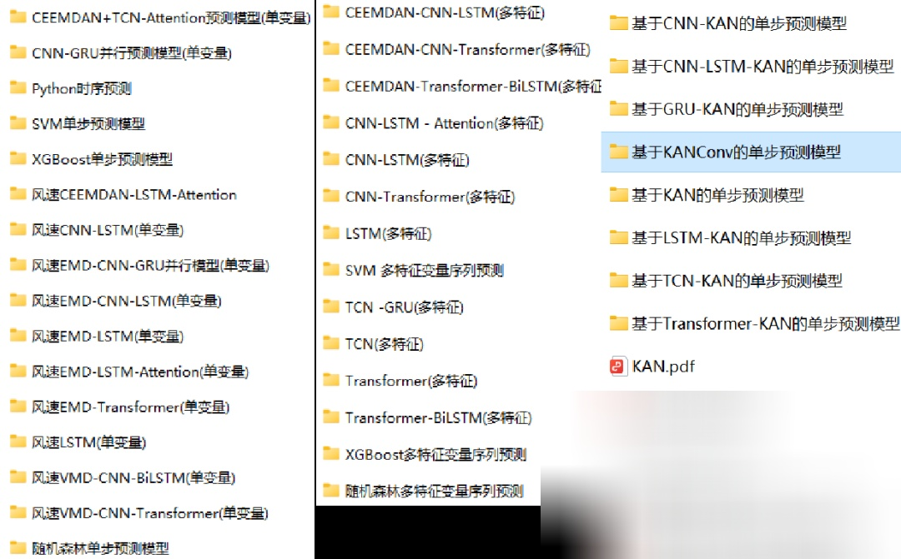

# Continuous Wavelet Transform (CWT) + Time Series Prediction! A New Approach to Fusion of Time-Frequency Analysis and Deep Learning for Prediction

Preface:
This update introduces a time series prediction method based on Continuous Wavelet Transform (CWT) and VGG models, which combines traditional time-frequency analysis techniques with deep learning to effectively solve the modeling challenges of complex time series. By converting one-dimensional time series signals into two-dimensional time-frequency images, it fully leverages the powerful feature extraction capability of convolutional neural networks (CNN) to ensure the local features of the time series while significantly enhancing the model's adaptability to non-stationary signals.
Single-step prediction family kit (single variable, multi-feature variables, wind speed, power load forecasting), comprehensive collection:
39 models including CNN, LSTM, Transformer, TCN, Attention, KAN, serial, parallel, and combined prediction models, EMD, VMD, CEEMDAN decomposition combined with deep learning models, machine learning forecasting, etc. All are here:
● Environment framework: Python 3.9, PyTorch 2.1 and above versions can run
● Code style: Jupyter format (provide VSCode, PyCharm running tutorials)
● Usage object: Paper requirements, graduation design requirements
● Code guarantee: Code comments detailed, ready to run at hand.
Including complete process data code processing:
The lowest price online, the best tutorial for beginner single-step prediction, download method:
1 Model introduction
Model core idea
 (1)Time-frequency conversion: Use CWT to capture the local characteristics of the time series signal in the time-frequency domain, generating high-resolution time-frequency images;
 (2)Feature learning: Use VGG model to extract deep semantic features from the time-frequency image;
 (3)Prediction modeling: Map the image features to future time points through a fully connected network.
2 Data processing flow
2.1 Sliding window introduction
In the context of time series prediction problems, sliding windows are a common data processing method used to convert time series data into input features for the model and output labels. The basic idea behind sliding windows is to slice the time series with a fixed window length, moving a certain step size each time, thereby generating a series of subsequences. These subsequences can serve as input features for the model, while the same length of data from the next time step can be used as output labels. This allows the time series data to be converted into a dataset suitable for supervised learning problems for training and testing predictive models.

Specifically, for a time series [x1, x2, x3, ..., xn], the process of sliding windows involves:

 (1)Select a fixed-length time window, such as w.
 (2)Starting from the beginning of the sequence, take the first w data points as input features and the data point w+1 as output labels to form the first sample.
 (3)Then, move forward by a fixed step size, taking the data points from positions 2 to w+1 as input features and the data point w+2 as output labels to form the second sample, and so on until the end of the sequence.
For example, if the sequence length is 20 and the sliding window is set to 4:

Training set:
Construct training set data and corresponding labels:

Test set:
Construct test set data and corresponding labels:

By processing through the sliding window, the original time series data is transformed into a series of samples, each containing a fixed-length input feature and its corresponding output label, which are used for model training and testing. The sliding window technique helps the model capture local patterns and trends in time series data, enhancing its predictive capabilities.
Data preprocessing and feature engineering process:
(1) Sliding window segmentation:
①Input: Original time series X={x1,x2,...,xT}
②Operation:
1. Window Length L: Clipping local temporal segments (e.g., L=128)
2. Generate window sequence: W={W1,W2,...,WN}, Wi={xi,xi+1,...,xi+L−1}
3. Continuous Wavelet Transform (CWT):
   ① Parameter configuration:
     - Wavelet basis function: Morlet wavelet ('morl', balanced for time-frequency resolution)
     - Scaling range: scales=[1,2,...,64]scales=[1,2,...,64] (controlling frequency resolution)
   ② Operation:
      Perform CWT on each window Wi to generate time-frequency image data.
4. Prediction Model Based on CWT + VGG:
   3.1 Define VGG model, set parameters, train the model
   3.2 Visualize prediction results
   3.3 Model evaluation
5. Prediction Model based on CWT + VGG:
   3.1 Define VGG model, set parameters, train the model
   3.2 Visualize prediction results
   3.3 Model evaluation
This paper mainly introduces a prediction idea of combining time-frequency images with deep learning models, and explores the transformation methods of time-frequency images, different parameter settings, different model combinations for prediction, etc. There is still much room for exploration!
For example, in the above model, the selection of wavelet basis function, other parameters such as: window value selection, wavelet parameters, time-frequency image parameters, etc., there are many different combinations to further improve the model prediction effect!
Click to download: Complete original data, Python code
Previously interesting content:
Time series prediction: Analysis and comparison of LSTM, ARIMA, Holt-Winters, SARIMA models
Wind speed prediction (I) Data introduction and preprocessing
Wind speed prediction (II) EMD-LSTM model based on Pytorch
Wind speed prediction (III) EMD-LSTM-Attention model
Wind speed prediction (IV) EMD-Transformer model based on Pytorch
Wind Speed Prediction (5) EMD-CNN-LSTM Model Based on PyTorch
Wind Speed Prediction (6) EMD-CNN-GRU Parallel Model Based on PyTorch
CEEMDAN + Combination Prediction Model (BiLSTM-Attention + ARIMA)
CEEMDAN + Combination Prediction Model (CNN-LSTM + ARIMA)
CEEMDAN + Combination Prediction Model (Transformer - BiLSTM + ARIMA)
CEEMDAN + Combination Prediction Model (CNN-Transformer + ARIMA)
Multi-Feature Variable Sequence Prediction (1) - CNN-LSTM Wind Speed Prediction Model
Multi-Feature Variable Sequence Prediction (2) - CNN-LSTM-Attention Wind Speed Prediction Model
Multi-Feature Variable Sequence Prediction (3) - CNN-Transformer Wind Speed Prediction Model
Multi-Feature Variable Sequence Prediction (4) - Transformer-BiLSTM Wind Speed Prediction Model
Multi-Feature Variable Sequence Prediction (5) - CEEMDAN+CNN-LSTM Wind Speed Prediction Model
Multi-Feature Variable Sequence Prediction (6) - CEEMDAN+CNN-Transformer Wind Speed Prediction Model
Prediction Model Based on SSA Optimized by Sparrow - CEEMDAN-BiLSTM-Attention
Prediction Model Based on SSA Optimized by Sparrow - CEEMDAN-Transformer-BiGRU
Superior Prediction Model: Secondary Decomposition-Combination Prediction
Multi-Feature Variable Sequence Prediction (7) - CEEMDAN+Transformer-BiLSTM Prediction Model
Multi-Feature Variable Sequence Prediction (8) - Prediction Model Based on SSA Optimized by Sparrow - CEEMDAN-SSA-BiLSTM Prediction Model
Multi-feature variable sequence prediction (11) - Pytorch-based TCN-GRU prediction model
VMD + CEEMDAN secondary decomposition, CNN-LSTM prediction model
VMD + CEEMDAN secondary decomposition, CNN-Transformer prediction model
VMD + CEEMDAN secondary decomposition, Transformer-BiGRU prediction model
Prediction model based on the Penghu optimization algorithm SSA - complete code package
| Superior combination prediction model!
High innovation | CEEMDAN + SSA-TCN-BiLSTM-Attention prediction model
| Superior combination prediction model!
Lowest price in the network | Continuously updated family of models!
| Parallel prediction model based on TCN-SENet + BiGRU-GlobalAttention
Secondary decomposition - innovative model prediction family package
| BiTCN-BiGRU-CrossAttention integrated spatiotemporal features high innovation prediction model
Combination prediction update | Superior combination prediction model!
Spatiotemporal feature fusion BiTCN-Transformer parallel prediction model
| Based on multi-level attention mechanism parallel prediction model
 | CEEMDAN-CNN-GRU-GlobalAttention + XGBoost combination prediction
Multi-step prediction series | LSTM, CNN, Transformer, TCN, serial, parallel model collection
END
2. Friends who like can click to follow, give the article a "like", share on WeChat or discuss groups

## Images

<!-- PAYMENT_BLOCK -->

## Get this dataset

- Payment link (Stripe): [Buy now](https://buy.stripe.com/3cs8yP7sY87d0vu9AB)
- Payment QR code: 

<!-- /PAYMENT_BLOCK -->
